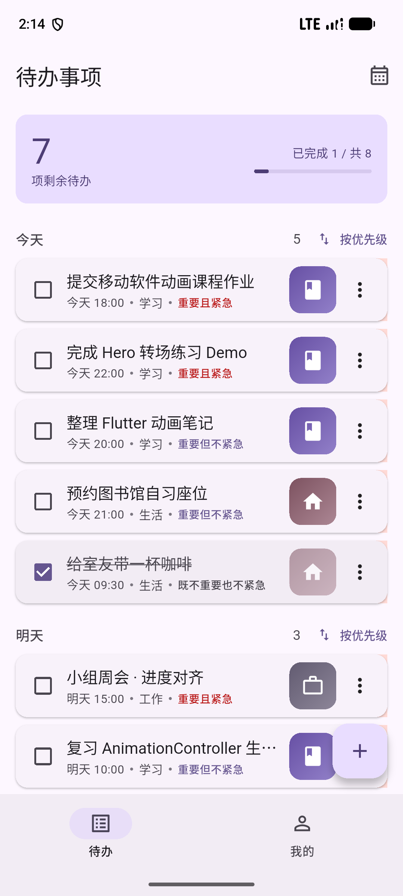
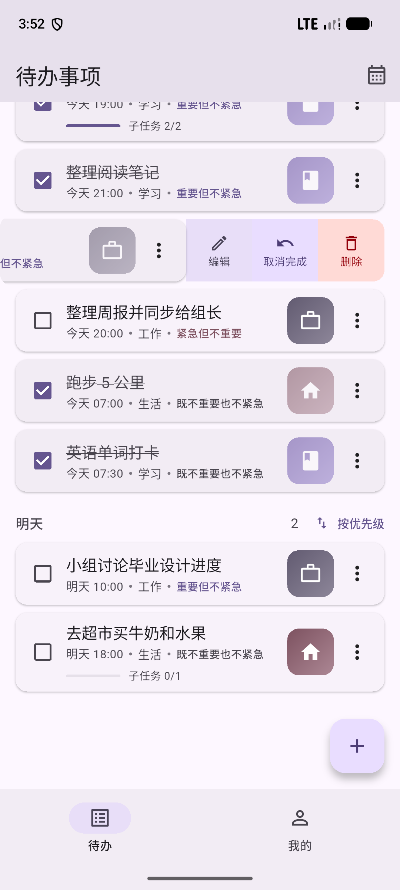
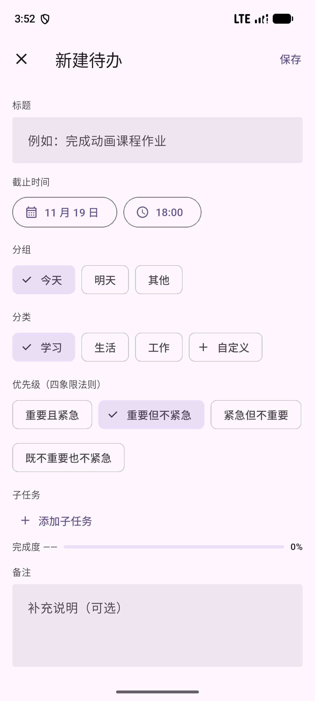
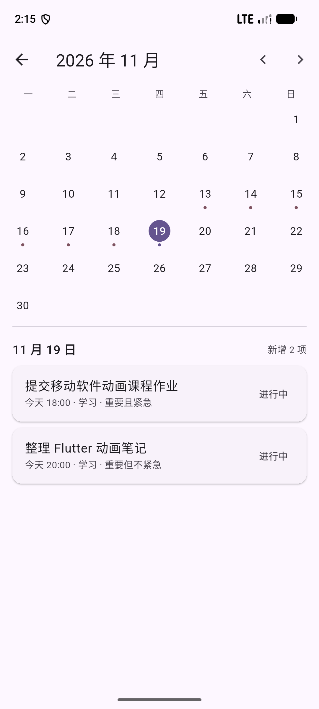
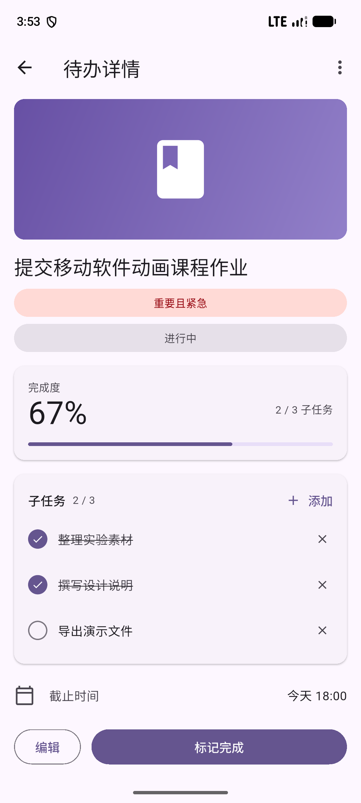
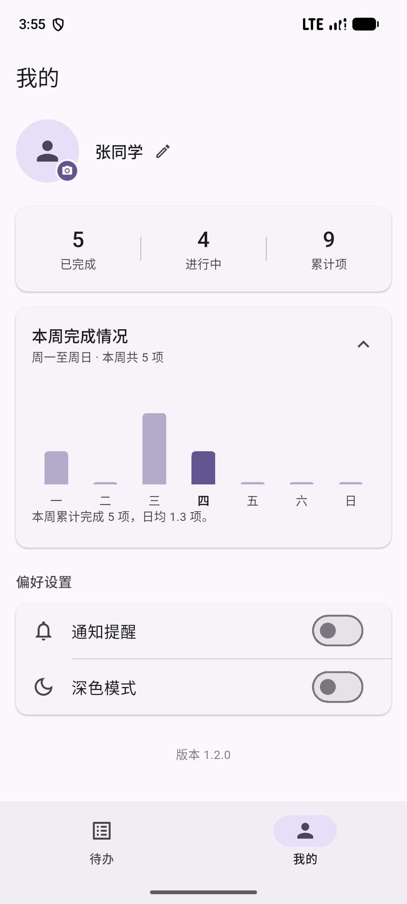
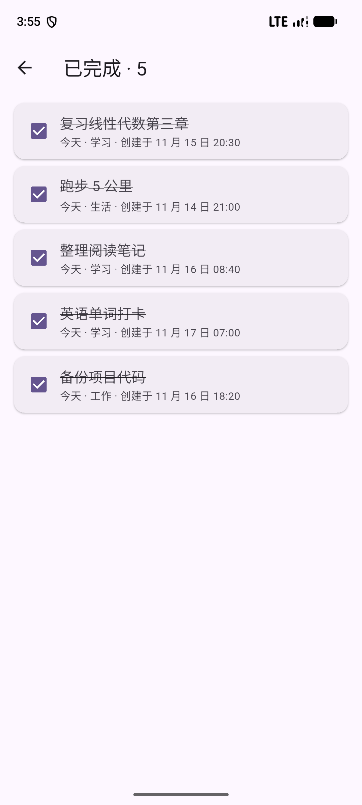
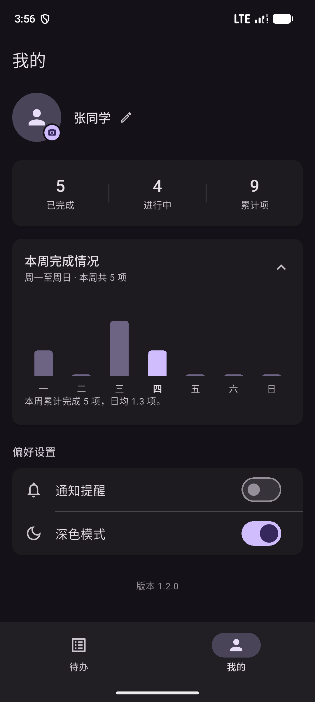

# ToDo · Flutter 待办清单

一个基于 Flutter（Material 3）实现的待办清单 App，配套单文件高保真 HTML 原型。

## 功能

- **待办管理**：新增、编辑、删除、标记完成，分组支持今天 / 明天 / 任意日期（不早于今天）
- **日历视图**：首页右上角进入日历页，按月翻页，按天查看当天新增了哪些待办
- **四象限优先级**：重要且紧急 / 重要但不紧急 / 紧急但不重要 / 既不重要也不紧急
- **独立排序**：每个日期列表可单独切换「按时间」或「按优先级」排序
- **左滑快捷操作**：首页任务左滑可编辑、标记完成、删除，三点菜单同样保留
- **自定义分类**：内置学习 / 生活 / 工作，可新增自己的分类
- **统计**：已完成 / 进行中 / 累计项动态计算，点击可查看对应条目列表
- **本地持久化**：全部待办与设置通过 `shared_preferences` 保存在本机
- **个性化**：从相册更换头像、修改姓名
- **偏好设置**：默认分组（今天 / 明天 / 其他）、深色模式、通知提醒
- **通知**：开启后新增待办会收到系统悬浮通知（Android 13+ 需授予通知权限）

## 界面预览

| 首页 | 左滑快捷操作 | 新建待办 |
| --- | --- | --- |
|  |  |  |
| **日历** | **待办详情** | **我的** |
|  |  |  |
| **统计明细** | **深色模式** | |
|  |  | |

> 截图取自 Android 模拟器（Pixel 6）运行 1.0.0 安装包的实拍画面。

## 目录结构

```
.
├── todo_app/                    Flutter 应用
│   ├── lib/
│   │   ├── main.dart            应用入口、亮/暗主题
│   │   ├── app_state.dart       全局状态 + 本地持久化（ChangeNotifier）
│   │   ├── notification_service.dart
│   │   ├── models/todo_item.dart
│   │   ├── pages/               home / detail / editor / calendar / stats_list / profile
│   │   └── widgets/             animated_counter / category_art / menu_row
│   ├── android/
│   ├── test/
│   └── pubspec.yaml
├── todo-app.html               单文件高保真交互原型
└── 组件样式参数说明.md          原型的设计参数与组件规范
```

## 运行

要求 Flutter 3.x / Dart 3.x。

```bash
cd todo_app
flutter pub get
flutter run
```

打包安装包：

```bash
flutter build apk --release
```

## 构建说明

仓库针对 Android SDK 36 环境做了两处兼容处理，若你的开发环境 SDK / CMake 完整，可按注释回退：

- `todo_app/android/build.gradle.kts`：将所有插件子工程的 `compileSdk` 统一提升到 36（适配本机仅安装 android-36 的情况）。
- `todo_app/pubspec.yaml` 的 `dependency_overrides`：把 `path_provider_android`、`shared_preferences_android` 固定到不依赖 `jni`（需要 CMake）的版本。

## HTML 原型

`todo-app.html` 可直接用浏览器打开，包含首页、详情、编辑、我的、日历、统计明细与设置对话框。原型数据保存在内存中，刷新后回到示例数据；真正的数据持久化在 Flutter 端。

## 版本

版本 1.1.0

## 版本更新

### v1.1.0

1. 分组时间范围扩展为今天 / 明天 / 其他，可选择任意不早于今天的日期与时刻
2. 「我的」默认分组同步改为今天 / 明天 / 其他
3. 优先级改为四象限法则，首页同一时间点内按优先级排序
4. 每个日期列表可独立切换「按时间」与「按优先级」两种排序
5. 新建待办支持自定义分类
6. 首页任务左滑可编辑 / 标记完成 / 删除，三点菜单保持不变
7. 应用名称改为 ToDo
8. 新增 ToDo 艺术字启动图标
9. `todo-app.html` 原型同步升级：任意日期分组、四象限优先级、按天独立排序、左滑快捷操作、自定义分类与 ToDo 图标

### v1.0.0

首个版本：待办管理、日历视图、统计明细、本地持久化、头像与姓名、深色模式、通知提醒。

## 手机下载


用手机扫描二维码即可直接下载安装包；也可以前往 [Releases](https://github.com/zzsycloud/todo-app-flutter/releases) 手动下载 `todo-app-release.apk`，或直接点击 [v1.1.0 安装包](https://github.com/zzsycloud/todo-app-flutter/releases/download/v1.1.0/todo-app-release.apk)。Android 13 及以上首次开启通知提醒时需授予通知权限。
